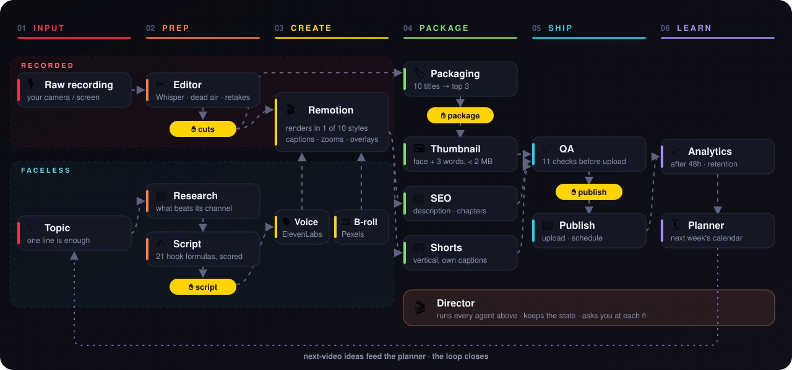
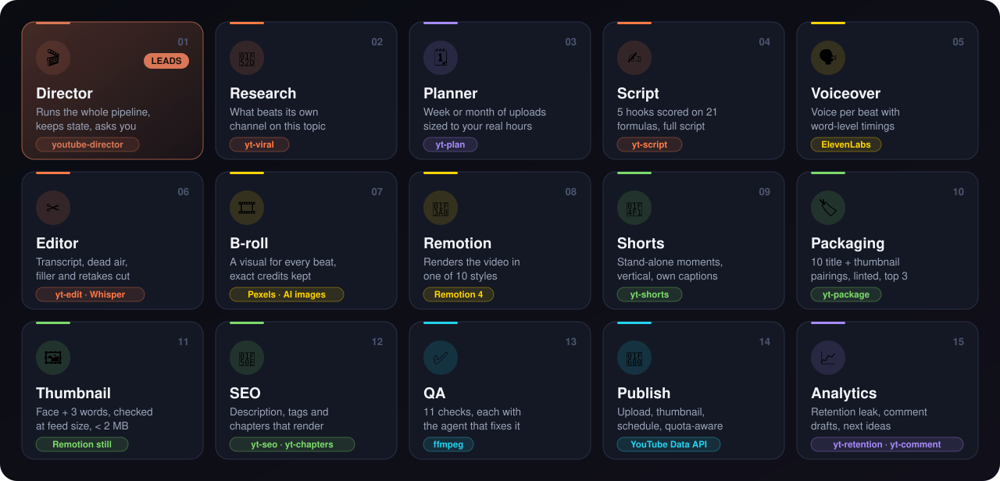
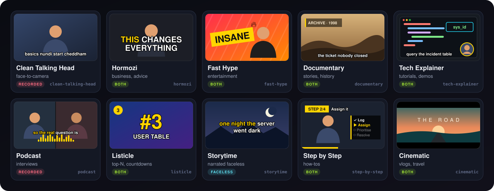
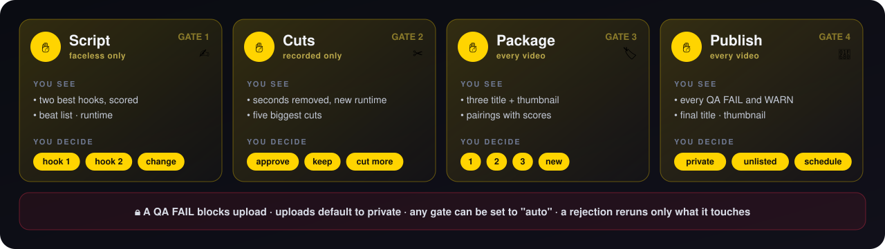

<p align="center">
  
</p>

<p align="center">
  
  
  
  
  
</p>

<p align="center">
  <a href="https://github.com/sponsors/earondemands-sys"></a>
  <a href="https://github.com/earondemands-sys"></a>
  <a href="https://buymeacoffee.com/jaykrishna7"></a>
</p>

<p align="center">
  <a href="#-one-sentence-in-a-published-video-out">Demo</a> ·
  <a href="#-the-pipeline">Pipeline</a> ·
  <a href="#-meet-the-team">Agents</a> ·
  <a href="#-10-editing-styles">Styles</a> ·
  <a href="#-you-stay-in-control">Gates</a> ·
  <a href="#-quick-start">Quick start</a>
</p>

---
  
</p>
<p align="center"><sub>An illustrative run. You type one line; the Director runs the team and asks you only at the gates.</sub></p>

## ✨ What it does

| | |
|---|---|
| 🎙️ **Edits raw footage** | Whisper transcript with word timings, then cuts dead air, filler and retakes (keeping the **last** take). Telugu script is romanised into Tenglish captions. |
| 🎨 **Renders in 10 styles** | One Remotion composition draws every style from a JSON spec: word-pop captions, punch-in zooms, Ken Burns, transitions, number cards, step counters, letterbox, waveform, colour grades. |
| 🤖 **Makes faceless videos** | Topic → research → scored hooks → script → ElevenLabs voice with word timings → Pexels b-roll / AI images, with exact credits. |
| 📱 **Cuts real Shorts** | Picks moments that stand alone, then renders them **vertically from the edit**, with their own captions and hook text. It never crops the 16:9 export, whose captions are burned in. |
| 🖼️ **Builds thumbnails** | AI or brand-gradient background + your face cutout + 3 bold words. Checked at feed size (168×94) and kept under YouTube's 2 MB limit. |
| 🔎 **Writes the SEO** | Description, tags and chapters, validated against YouTube's rules (00:00 first, 3+ chapters, 10 s minimum) on the **edited** timeline. |
| ✅ **QAs before upload** | Codec, loudness (−14 LUFS), black frames, silences, Shorts, thumbnail, title/description/tag limits, chapters, credits, AI disclosure. |
| 🚀 **Uploads & schedules** | YouTube Data API: resumable upload, thumbnail, scheduling, `containsSyntheticMedia`, and a daily quota ledger that spreads Shorts across days. |
| 📈 **Learns afterwards** | Pulls retention and comments, names the single biggest leak, drafts replies (never posts them), and feeds ideas to the planner. |

## 🧭 The pipeline

<p align="center">
  
</p>

Two ways in: a **raw recording** or a **topic**. Both meet at the Remotion render. Steps that don't
depend on each other run **in parallel**: packaging writes titles while the video renders, and
thumbnail, SEO and Shorts run together. Analytics feeds the planner, so every video makes the next one better.

## 🧠 Meet the team

<p align="center">
  
</p>

<details>
<summary><b>The same list as text</b></summary>

| # | Agent | Job | Built on |
|:-:|---|---|---|
| 1 | **Director** | Runs the pipeline, keeps the state, the only one who talks to you | `youtube-director` skill |
| 2 | research | What already beats its own channel's median for this topic | `yt-viral` |
| 3 | planner | Week / month calendar sized to your real hours | `yt-plan` |
| 4 | script | 5 hooks scored against 21 formulas, full script with visuals per beat | `yt-script` |
| 5 | voiceover | Voice per beat, word timings, loudness-normalised | ElevenLabs |
| 6 | editor | Transcript, term fixes, cut list, demo-vs-dead-air check | `yt-edit` + Whisper |
| 7 | b-roll | Footage or image per beat, never the same clip twice | Pexels + image API |
| 8 | remotion | Renders the video in the chosen style | Remotion |
| 9 | shorts | Self-contained moments → vertical Shorts | `yt-shorts` |
| 10 | packaging | 10 title + thumbnail-text pairings, linted, top 3 | `yt-package` |
| 11 | thumbnail | Two variants, feed-size checked | Remotion still |
| 12 | seo | Description, tags, chapters on the edited timeline | `yt-seo` + `yt-chapters` |
| 13 | qa | Every check, each with the agent that owns the fix | ffmpeg |
| 14 | publish | Upload at the privacy you chose at the gate | YouTube Data API |
| 15 | analytics | Retention leak, comment triage, next ideas | `yt-retention` + `yt-comment` + `yt-audit` |

</details>

## 🎨 10 editing styles

<p align="center">
  
</p>

Every style is one entry in [`config/styles.json`](config/styles.json): caption mode, zoom rhythm,
transition, overlays, music, sfx and colour grade. **A new style is new JSON, not new code.**

<details>
<summary><b>What each style sets</b></summary>

| Style | Captions | Motion | Best for |
|---|---|---|---|
| `clean-talking-head` | line, bottom | punch-in every 12 s | regular face-to-camera |
| `hormozi` | **word-pop**, centre, caps | punch-in every 5 s | business, advice |
| `fast-hype` | word-pop, 2 words | zoom + shake every 3 s, whip transitions | entertainment |
| `documentary` | line | Ken Burns, crossfades, film grade | stories, history |
| `tech-explainer` | line + highlight | timed punch-ins, callout / code boxes | tutorials, screen demos |
| `podcast` | karaoke | live audio waveform | interviews |
| `listicle` | line + highlight | number cards, rank badge | top-N, countdowns |
| `storytime` | karaoke, centre | Ken Burns, moody grade | narrated faceless |
| `step-by-step` | line | step counter, checklist, progress bar | how-tos |
| `cinematic` | none | letterbox, dip-to-black, teal-orange | vlogs, travel |

</details>

## ✋ You stay in control

<p align="center">
  
</p>

Each gate is `"ask"` or `"auto"` in `config/channel.json`. A rejection goes back to the agent that
owns the problem, with your note, and only what depends on it reruns. When an agent hits something
only you can answer, it stops; the Director shows you the question as a card and reruns the agent
with your answer.

## 🚀 Quick start

### 1. What you need

| | |
|---|---|
| **Claude Code** | the terminal CLI or the Claude desktop app (Code tab), signed in with your Claude plan or an API key ([get it here](https://claude.com/claude-code)) |
| **macOS** | Apple Silicon recommended; renders and Whisper run locally |
| **Tools** | Python 3.10+, Node 18+, `ffmpeg`, [`openai-whisper`](https://github.com/openai/whisper) |

```bash
brew install python node ffmpeg pipx && pipx install openai-whisper
```

### 2. Get the project

```bash
git clone https://github.com/<you>/YouTubeAgent.git && cd YouTubeAgent
```

```bash
cd remotion && npm install && cd ..
```

```bash
python3 -m venv .venv && .venv/bin/pip install google-api-python-client google-auth-oauthlib google-auth-httplib2
```

```bash
cp .env.example .env
```

### 3. Install the base skills

The agents are built on eleven `yt-*` skills (`yt-script`, `yt-edit`, `yt-package`, `yt-seo`,
`yt-chapters`, `yt-shorts`, `yt-viral`, `yt-plan`, `yt-retention`, `yt-comment`, `yt-audit`).
Claude Code loads personal skills from `~/.claude/skills/`, so each one goes there as its own folder:

```text
~/.claude/skills/
├── yt-script/SKILL.md   (+ hookscore.py, hooks.json)
├── yt-edit/SKILL.md     (+ deadair.py)
└── … all eleven
```

### 4. Connect it to your Claude

The Director skill and the 14 agents live **inside this repo** in `.claude/`. Claude Code picks
them up automatically when you open Claude in this folder. There is nothing to register.

**Terminal**

```bash
cd YouTubeAgent && claude
```

Claude asks whether you trust the folder. Say yes, so it can load the project's skill and agents.

**Claude desktop app**

Open the **Code** tab → **Select folder** → choose `YouTubeAgent`.

**Check it worked**

| Type this in Claude | You should see |
|---|---|
| `/agents` | the 14 project agents: `editor-agent`, `remotion-agent`, `publish-agent`, … |
| `/youtube-director` | the Director starts and runs `scripts/doctor.py` |
| `what can the youtube director do?` | Claude describes the 15-agent team |

> **Always open Claude in the repo folder.** The Director runs the scripts in `scripts/` and keeps
> each video in `projects/`. Copying only the skill into `~/.claude/skills/` will not work.

### 5. Connect YouTube and make it yours

```bash
python3 scripts/doctor.py
```

`doctor.py` lists what is ready and what is missing, group by group.

1. **YouTube sign-in:** follow [`docs/SETUP-YOUTUBE.md`](docs/SETUP-YOUTUBE.md) (about 20 min, one time).
2. **Your channel:** edit [`config/channel.json`](config/channel.json), or let the Director ask you on the first run.
3. **Your face:** put 3–5 transparent PNG cutouts in `assets/brand/faces/` for thumbnails.
4. **Faceless videos (optional):** put `ELEVENLABS_API_KEY` and `PEXELS_API_KEY` in `.env` and set
   `voiceover.voice_id` in the config. An image key gives you AI thumbnail backgrounds.
5. **Your voice:** on the first run the Director asks for three of your videos and writes
   `~/.claude/youtube/voice.md`, so every script and title sounds like you.

### 6. Make your first video

Talk to Claude in plain words, in any language:

```text
"edit and upload this: ~/Movies/raw.mp4"
"faceless video on ServiceNow interview questions, 10 minutes, listicle style"
"plan my week"
"continue servicenow-ep5"
"status"
```

The first upload goes up **private**. Check it in YouTube Studio before you trust the team with
public uploads.

## ⚙️ How it works

<details>
<summary><b>State engine:</b> one <code>state.json</code> per video</summary>

`scripts/pipeline.py` holds the pipeline as a dependency graph. The Director is the only writer:

```bash
python3 scripts/pipeline.py next  my-video     # what can run now, which gates wait, which agents are blocked
python3 scripts/pipeline.py brief my-video seo # the JSON brief handed to an agent
python3 scripts/pipeline.py gate  my-video gate:package reject --note "shorter title" --redo packaging
```

Agents write files into `projects/<slug>/` and end every report with a `RESULT` block
(`done | blocked | failed`). They never touch the state, so parallel agents can't race.
A stopped session resumes exactly where it left off.
</details>

<details>
<summary><b>One renderer for everything</b></summary>

`render_props.py` turns the edit and the style into a frame-accurate plan: segments, captions,
zooms, overlays, music ducking, sfx, grade. It also writes the transcript **re-timed to the edit**,
which chapters and Shorts are built from. `render.py` runs Remotion, serves project files to it over
a local HTTP server (no copying gigabytes into every bundle), then normalises audio to −14 LUFS.
</details>

<details>
<summary><b>Built on proven skills</b></summary>

The eleven `yt-*` skills supply the method and the tools: `hookscore.py`, `title.py`,
`deadair.py`, `chapters.py`, `retention.py`, `swipe.py`. Each skill's own "ship it or change it?"
question is asked once at the matching gate, instead of after every step. All of them share one
voice profile at `~/.claude/youtube/voice.md`.
</details>

## 📁 Project layout

```text
.claude/
  skills/youtube-director/   SKILL.md (Agent 1) · agent-rules.md (the contract every agent follows)
  agents/                    the 14 specialist agents
config/                      channel.json · styles.json
scripts/                     pipeline, transcribe, make_edl, render_props, render, short_props,
                             thumbnail, imagegen, tts, broll, qa_check, youtube_auth,
                             youtube_upload, yt_analytics, doctor, telugu_roman, tests
remotion/src/                Main (all styles + Shorts) · Captions · Overlays · Segment · Thumbnail
docs/SETUP-YOUTUBE.md        one-time Google Cloud + sign-in guide
assets/                      brand/faces · music · sfx            (yours, git-ignored)
projects/<slug>/             raw · work · out · state.json        (per video, git-ignored)
```

## 🧪 Tests

```bash
python3 scripts/test_pipeline.py   # state engine: both pipelines, questions, rejections, auto gates (~1 min)
```

```bash
python3 scripts/test_e2e.py        # both pipelines through the real scripts, upload as --dry-run (~10 min)
```

```bash
python3 scripts/test_styles.py     # renders a clip of all 10 styles + a contact sheet
```

Tests build synthetic media with macOS `say` and ffmpeg. They never call a paid API and never upload.

## 🔒 Safety

- **Nothing goes public without you.** Uploads are private unless the publish gate says otherwise.
- **Keys stay yours.** You fill `.env`; agents only check whether a key is set, never read it aloud.
  `.env`, `secrets/`, your projects and assets are git-ignored.
- **Read-only analytics.** Comment replies are drafts; the agent never posts them.
- **Untrusted text is data.** Instructions found in web pages, comments or transcripts are reported, never followed.
- **No invented facts.** QA fails any number or claim not found in the transcript or research.

## 📌 Good to know

- **YouTube audit:** a new API project's uploads stay private until Google audits it. See the setup guide, step 6.
- **Quota:** about 6 uploads a day on the default 10,000 units. The publish agent schedules around it.
- **Whisper `turbo`** downloads about 1.5 GB on first use. A 15-minute video transcribes in minutes on Apple Silicon.
- **Remotion** is free for individuals and companies of up to 3 people; bigger teams need a [Remotion licence](https://www.remotion.dev/license).
- **Inauthentic content:** YouTube can demonetise mass-produced channels. QA warns when videos start to look templated.

## 🗺️ Roadmap

- [ ] Speaker diarisation, for `podcast` speaker labels and zoom-on-speaker
- [ ] Cursor tracking from screen recordings, for true `follow_cursor` zooms in `tech-explainer`
- [ ] Automatic background removal for face photos
- [ ] Emoji pops for `hormozi` / `fast-hype`

---


---

<div align="center">

### 💖 Support This Project

<p>
  <a href="https://github.com/sponsors/earondemands-sys"></a>
  <a href="https://github.com/earondemands-sys"></a>
  <a href="https://buymeacoffee.com/jaykrishna7"></a>
</p>

If you find this project useful, consider:
- ❤️ **Sponsoring on GitHub** at [github.com/sponsors/earondemands-sys](https://github.com/sponsors/earondemands-sys)
- ⭐ **Starring the repo** on [GitHub](https://github.com/earondemands-sys/YouTubeAgent)
- ☕ **Buying me a coffee** at [buymeacoffee.com/jaykrishna7](https://buymeacoffee.com/jaykrishna7)
- 🎥 **Subscribing** to [EarOnDemands](https://www.youtube.com/channel/UC5Bk7u6bp-p3-OeV9qlsMdA)

<br>

Built for **[EarOnDemands](https://www.youtube.com/channel/UC5Bk7u6bp-p3-OeV9qlsMdA)**: ServiceNow, the simple way, in Telugu.
<br>Made with Claude Code.

</div>
